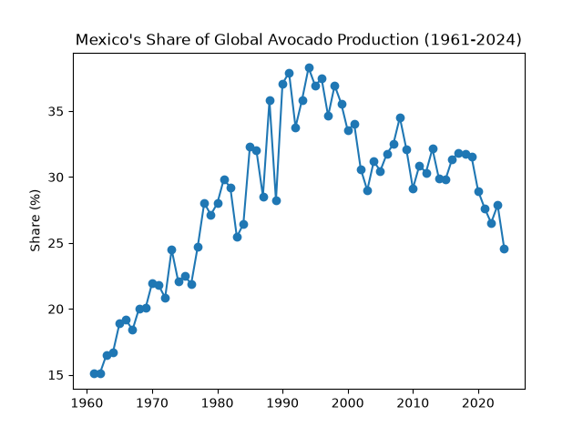
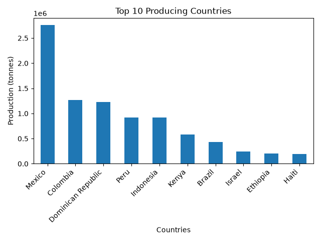

# Avocado Production Analysis

Is Mexico still the world's dominant avocado producer? An analysis of 60+ years of FAO production data.

## Key results
- Mexico's share of world production rose from about 15% in 1961 to a peak of about 38% around 1994, and has trended downward since, while still moving up and down.
- In 2023, Mexico remained #1 by a wide margin, but Indonesia ranked #4, producing almost as much as Peru, a well-known export powerhouse, yet it barely appears in export markets.
- The raw data mixes countries with regional and income-group aggregates. I filtered to real countries using the 3-letter country code, and validated the result against the official world total.



## Question
Is Mexico still the one dominant producer of avocados in the world?

## Data
- Our World in Data (based on FAO), 1961–2024
- Loaded directly from the URL with pandas

## Findings
Mexico's share of world production kept rising until it peaked at about 38% around 1994. Since then it has gone up and down, with an overall downward trend.

In 2023, Mexico still produced far more than any other country. The surprising one is Indonesia: it ranked #4, with almost the same production as Peru, which is known as a major exporter. Yet Indonesia is rarely mentioned in export markets.



## How I cleaned the data
The `Entity` column contained not only countries but also aggregates such as `Asia`, `World`, and `Upper-middle-income countries`. Adding them up would count the same country several times.

Checking hundreds of names one by one was not realistic, so I looked for a pattern that could separate countries from aggregates. I found that only real countries have a 3-letter `Code`, so I kept the rows where the code length is 3.

To check that the filter was correct, I compared the sum of all countries with the `World` total provided by Our World in Data. The two matched within 0.1%, which confirmed that no countries were double-counted or missing.

## Next steps
- Use export data to test why Indonesia produces so much but exports so little (for example, whether most of it is consumed domestically).

## How to run
```bash
python3 analysis.py
```